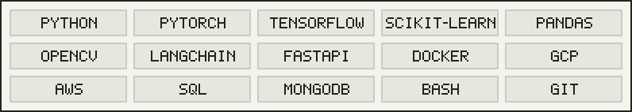

  &nbsp;
  &nbsp;
  

Hi! I'm **Diego Machado**, aka *diegulio*. I'm an industrial engineer with a master's in engineering sciences, working as a data scientist and teaching at USACH. I learn by building: papers turned into code, experiments with models, and explanations without the jargon.

`Classical ML` `Time Series` `NLP` `Computer Vision` `Audio` `LLMs`

<table>
<tr>
<td width="50%"><b><a href="https://pytorch-transform-illustrations.streamlit.app">PyTorch Augmentations Illustrated</a></b> Play with PyTorch data augmentations interactively.</td>
<td width="50%"><b><a href="https://pypi.org/project/back-to-sit/">Back to Sit</a></b> Python library that pings you on Telegram when your code is done.</td>
</tr>
<tr>
<td><b><a href="https://github.com/diegulio/llm-recipe">LLM Recipe</a></b> Tell it a dish, get the ingredients and the recipe.</td>
<td><b><a href="https://github.com/diegulio/llm-cv-helper">LLM CV Reviewer</a></b> LLM app that helps you review resumes.</td>
</tr>
<tr>
<td><b><a href="https://github.com/diegulio/pytorch-breed-classification">PyTorch Breed Classification</a></b> Lightning benchmark of top CNNs on 120 dog breeds, cats and "none".</td>
<td><b><a href="https://github.com/diegulio/Pelao_invaders">Pelao Invaders</a></b> A space shooter I made with pygame.</td>
</tr>
</table>

- `ENE 2026` [ChatGPT Sin Tecnicismos](https://diegulio.github.io/post.html?slug=chatgpt-sin-tecnicismos): how ChatGPT works, explained intuitively.
- `SEP 2025` [Leveraging MCPs with LLMs](https://diegulio.github.io/post.html?slug=mcp): a framework for studying efficiently with MCPs.
- `FEB 2024` [Paper Implementation Series: GANs](https://diegulio.github.io/post.html?slug=gan): the original GAN paper, implemented.
- `OCT 2023` [Image Classification with PyTorch Lightning](https://diegulio.github.io/post.html?slug=pytorch-breed-classification)
- `JUL 2023` [Data ❤️ Chat: Chatea con tu Curriculum](https://diegulio.github.io/post.html?slug=llm-cv-assistant)

→ <a href="https://diegulio.github.io/#blog">All 9 experiments on the blog</a>

Running, swimming, cycling and strength training. *Fuerza + constancia.*

Every pixel here is drawn with code · Santiago, CL

